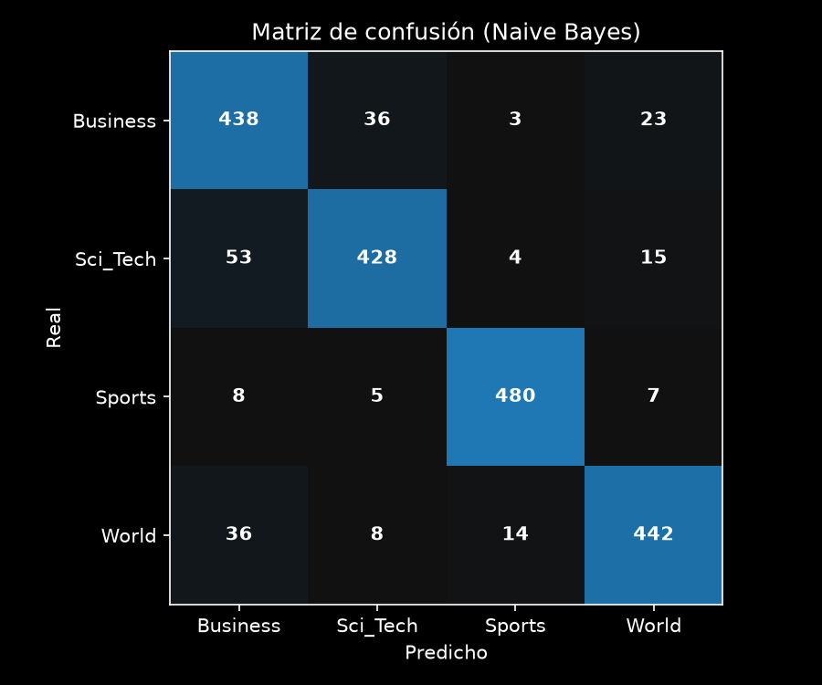

# Clasificador de noticias con TF-IDF

Tercer checkpoint del proyecto integrador. Clasifica las noticias de AG News en 4 categorías (World, Sports, Business, Sci_Tech) usando TF-IDF y un modelo de machine learning clásico, y sirve de baseline para los próximos módulos.

## Estructura

```
data/           ag_news_train.csv y ag_news_test.csv (los splits de la cátedra)
src/            clasificador_tfidf.py
results/        corpus preprocesado, tabla de experimentos, reporte y matriz de confusión
requirements.txt
README.md
```

## Cómo correrlo

Desde la carpeta raíz del proyecto:

```
pip install -r requirements.txt
python -m spacy download en_core_web_sm
python src/clasificador_tfidf.py
```

La primera vez tarda unos minutos porque preprocesa el texto con spaCy. El corpus procesado se guarda en `results/` y las siguientes corridas lo reutilizan.

## Lo que hace el código

- **Datos:** uso los splits de la cátedra: 8.000 noticias para train y 2.000 para test, con 2.000 y 500 por categoría respectivamente.
- **Preprocesamiento:** el mismo del Módulo 2: saco el HTML escapado y los links, paso a minúsculas, borro nombres de agencias (reuters, ap, afp) y restos de comillas (quot), dejo solo letras y lematizo con spaCy.
- **Elección de parámetros:** separé 20% del train como validación (estratificada) y probé 18 combinaciones: 3 valores de `max_features`, 2 de `ngram_range` y 3 modelos. El test no lo toqué para elegir.
- **Sin data leakage:** el `TfidfVectorizer` hace `fit` solo con el train (o con el sub-train en los experimentos) y el test solo se transforma.
- **Modelo final:** con la mejor combinación entreno con todo el train y evalúo una sola vez en el test.
- **Semilla:** `random_state=42` en la división.

## Parámetros del vectorizador

- **`max_features=20000`:** limita el vocabulario a las 20.000 palabras más frecuentes. Con unigramas el corpus tiene 16.697 palabras distintas, así que en la práctica usa todo el vocabulario. Con 1.000 el resultado empeoró bastante.
- **`ngram_range=(1, 1)`:** solo palabras sueltas. Probé también (1, 2), con bigramas.
- **`stop_words='english'`:** saca las palabras muy comunes que no aportan para clasificar.

## Resultados

Experimentos en validación (F1 macro), mejor combinación de cada modelo:

| Modelo | max_features | ngram_range | F1 macro (val) |
|---|---|---|---|
| Naive Bayes | 20000 | (1, 1) | 0.8977 |
| Linear SVC | 20000 | (1, 2) | 0.8945 |
| Regresión Logística | 20000 | (1, 2) | 0.8934 |

Resultado final en test (Naive Bayes, `max_features=20000`, `ngram_range=(1, 1)`):

| Categoría | Precision | Recall | F1 |
|---|---|---|---|
| Business | 0.819 | 0.876 | 0.846 |
| Sci_Tech | 0.897 | 0.856 | 0.876 |
| Sports | 0.958 | 0.960 | 0.959 |
| World | 0.908 | 0.884 | 0.896 |
| **Accuracy** | | | **0.894** |

El F1 macro en test es 0.894. La tabla completa de experimentos está en `results/experimentos.csv` y el reporte en `results/classification_report.txt`.

## Por qué Naive Bayes

Elegí Naive Bayes porque fue el que mejor F1 dio en validación (0.8977). Además es el más simple y el más rápido de entrenar, y funciona bien con vectores TF-IDF de texto. Igual, la diferencia con Linear SVC y Regresión Logística es chica (menos de 0.5 puntos), así que con este corpus los tres sirven como baseline. Elegí en validación y no en test, para que el resultado final sea una estimación limpia.

Sobre los parámetros: usar solo 1.000 palabras bajó el F1 a 0.86, es decir que perdía información. Los bigramas ayudaron un poco a Regresión Logística y a SVM (entre 0.2 y 0.3 puntos), pero a Naive Bayes le restaron un poco, y la diferencia en todos los casos es pequeña.

## Análisis de la matriz de confusión



- **Sports es la más fácil:** 480 de 500 bien clasificadas (F1 0.959). Tiene vocabulario muy propio (equipos, partidos, jugadores).
- **Business es la más difícil** (F1 0.846), sobre todo por precisión: el modelo la predice de más y recibe errores de las otras categorías (53 de Sci_Tech, 36 de World y 8 de Sports).
- **La confusión más grande es entre Sci_Tech y Business:** 53 noticias de Sci_Tech se predijeron como Business y 36 al revés. Mi hipótesis es que muchas noticias de tecnología hablan de empresas, compras y ganancias, y comparten palabras con las de negocios.
- **Business y World también se mezclan** (36 y 23 errores en cada sentido), probablemente por noticias de economía internacional como petróleo o comercio.

Esto es una interpretación a partir de los números de la matriz, y no lo comprobé leyendo los errores uno por uno.
